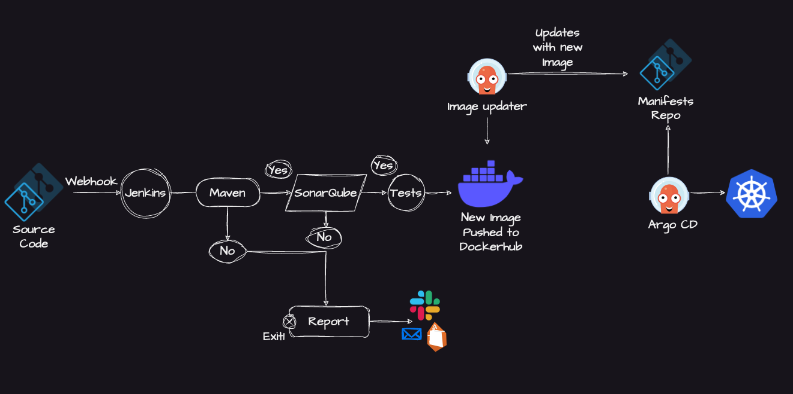

# NextGen CD — GitOps Continuous Delivery

This repository contains the Kubernetes manifests and GitOps deployment configurations for the **NextGen Coding Platform**. Argo CD watches this repository to automatically synchronize and deploy desired state to the Kubernetes cluster.

---

## 🏛️ CI/CD Architecture Flow



### End-to-End Workflow

1. **Source Code & Webhook**:
   - Developers push changes to the source repository ([`Coding-Plateform`](https://github.com/AnuragGupta181/Coding-Plateform)).
   - GitHub webhook triggers the Jenkins CI pipeline on push.

2. **Continuous Integration (Jenkins — EC2 #1)**:
   - **Checkout**: Jenkins pulls the latest source code.
   - **Build & Test**: Installs dependencies and runs unit / integration tests for both backend and frontend.
   - **SonarQube Quality Gate**: Static code analysis ensures code quality, security vulnerabilities, and coverage metrics pass. Pipeline is **blocked** if the quality gate fails.
   - **Docker Build & Push**: Container images are built on the EC2 runner and pushed to Docker Hub.
   - **Trivy Vulnerability Scan**: Scans container images for HIGH/CRITICAL CVEs in OS packages and application dependencies before deployment.
   - **Email Notification**: Automated status reports are sent on success or failure.

3. **Container Registry (Docker Hub)**:
   - Images are tagged with build numbers (`anurag181/nextgen-backend:${BUILD_NUMBER}`) and `latest`.
   - Both backend and frontend images are pushed.

4. **Manifest Updater (GitOps Sync)**:
   - Jenkins updates the deployment image tags in [`k8s/deploy.yml`](./k8s/deploy.yml) and [`k8s/frontend-deploy.yml`](./k8s/frontend-deploy.yml) and commits the change.

5. **Continuous Deployment (Argo CD & Kubernetes — EC2 #2)**:
   - Argo CD detects commits in this repository.
   - Automatically synchronizes the target state with the live Kubernetes cluster (`nextgen` namespace).
   - Zero-downtime rolling updates apply the new release.

6. **Secrets Management (Bitnami Sealed Secrets)**:
   - Secrets are encrypted with `kubeseal` and stored as `SealedSecret` resources in Git.
   - The Sealed Secrets controller running inside K8s decrypts them into regular `Secret` objects.
   - Raw secrets are **never** committed to Git.

---

## 📁 Repository Structure

```
.
├── architecture.png            # CI/CD architecture diagram
├── .gitignore                  # Ignores sensitive secrets, terraform state, IDE files
├── README.md                   # This file
├── terraform/                  # Infrastructure as Code (future)
└── k8s/
    ├── namespace.yml           # Creates the 'nextgen' namespace
    ├── configmap.yml           # App configuration (NODE_ENV, PORT, CORS)
    ├── secrets.example.yml     # Template for base64-encoded secrets
    ├── sealed-secrets.yml      # 🔒 Encrypted secrets (safe to commit)
    ├── sealed-secrets-install.md  # Sealed Secrets controller setup guide
    ├── seal-secrets.sh         # One-command script to generate sealed secrets
    ├── encode-secrets.sh       # Legacy utility to encode .env into base64
    ├── deploy.yml              # Backend deployment (3 replicas, probes, resources)
    ├── frontend-deploy.yml     # Frontend deployment (2 replicas, Nginx)
    ├── service.yml             # Backend NodePort service (port 30500)
    ├── frontend-service.yml    # Frontend ClusterIP service (port 80)
    ├── ingress.yml             # NGINX Ingress — routes /api→backend, /→frontend
    └── pod.yml                 # Standalone backend test pod
```

---

## 🚀 Deployment Instructions

### 1. Configure Secrets (Sealed Secrets — Recommended)

> **🔒 Recommended approach:** Use Bitnami Sealed Secrets so secrets are encrypted and can be safely stored in Git.

**Step 1 — Install the Sealed Secrets controller on your K8s cluster:**

```bash
helm repo add sealed-secrets https://bitnami-labs.github.io/sealed-secrets
helm repo update
helm install sealed-secrets sealed-secrets/sealed-secrets \
  --namespace kube-system \
  --set fullnameOverride=sealed-secrets-controller
```

**Step 2 — Install `kubeseal` CLI on your local machine:**

```bash
# macOS
brew install kubeseal

# Linux
KUBESEAL_VERSION=$(curl -s https://api.github.com/repos/bitnami-labs/sealed-secrets/releases/latest | grep tag_name | cut -d '"' -f4)
wget "https://github.com/bitnami-labs/sealed-secrets/releases/download/${KUBESEAL_VERSION}/kubeseal-${KUBESEAL_VERSION#v}-linux-amd64.tar.gz"
tar -xvzf kubeseal-*.tar.gz kubeseal
sudo install -m 755 kubeseal /usr/local/bin/kubeseal
```

**Step 3 — Generate sealed secrets from your `.env` file:**

```bash
cd k8s
bash seal-secrets.sh ../../Coding-Plateform/Backend/.env
```

This encrypts your secrets and writes `k8s/sealed-secrets.yml`. Commit and push it — ArgoCD will apply it and the controller decrypts it inside the cluster.

### Alternative: Manual Secrets (not recommended for production)

```bash
kubectl create secret generic backend-secrets \
  --namespace=nextgen \
  --from-env-file=../../Coding-Plateform/Backend/.env
```

### 2. Manual Deployment Order

```bash
kubectl apply -f k8s/namespace.yml
kubectl apply -f k8s/configmap.yml
kubectl apply -f k8s/sealed-secrets.yml    # or secrets.yml for manual approach
kubectl apply -f k8s/deploy.yml
kubectl apply -f k8s/frontend-deploy.yml
kubectl apply -f k8s/service.yml
kubectl apply -f k8s/frontend-service.yml
kubectl apply -f k8s/ingress.yml
```

### 3. Verify Deployment

```bash
# Check all resources in the nextgen namespace
kubectl get all -n nextgen

# Check backend pod logs
kubectl logs -n nextgen -l app=coding-platform-backend

# Check frontend pod logs
kubectl logs -n nextgen -l app=coding-platform-frontend

# Check deployment rollout status
kubectl rollout status deployment/backend -n nextgen
kubectl rollout status deployment/frontend -n nextgen
```

---

## 🤖 Argo CD Application Setup

To deploy via Argo CD, create an Argo CD Application referencing this repository:

```yaml
apiVersion: argoproj.io/v1alpha1
kind: Application
metadata:
  name: nextgen-platform
  namespace: argocd
spec:
  project: default
  source:
    repoURL: 'https://github.com/AnuragGupta181/nextgen_cd.git'
    targetRevision: HEAD
    path: k8s
  destination:
    server: 'https://kubernetes.default.svc'
    namespace: nextgen
  syncPolicy:
    automated:
      prune: true
      selfHeal: true
    syncOptions:
      - CreateNamespace=true
```

---

## 🖥️ Infrastructure Layout

| Component | Location | Purpose |
|-----------|----------|---------|
| **Jenkins + SonarQube** | EC2 #1 (`15.207.14.85`) | CI — builds, tests, scans, pushes images |
| **K8s Cluster + ArgoCD** | EC2 #2 | CD — runs the app, syncs from this repo |
| **Docker Hub** | `anurag181/*` | Container image registry |
| **GitHub** | `AnuragGupta181/Coding-Plateform` | Application source code |
| **GitHub** | `AnuragGupta181/nextgen_cd` | This repo — deployment manifests |
